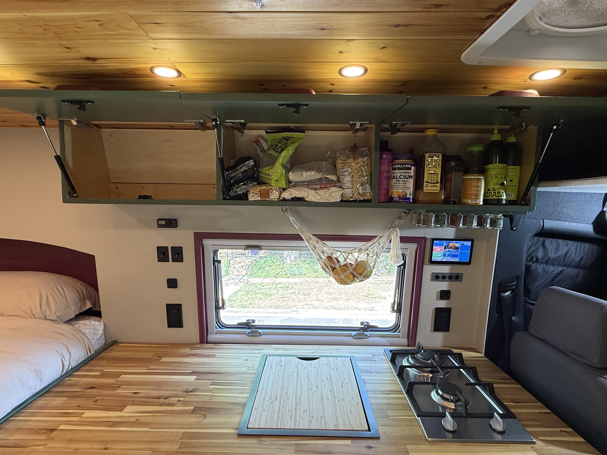
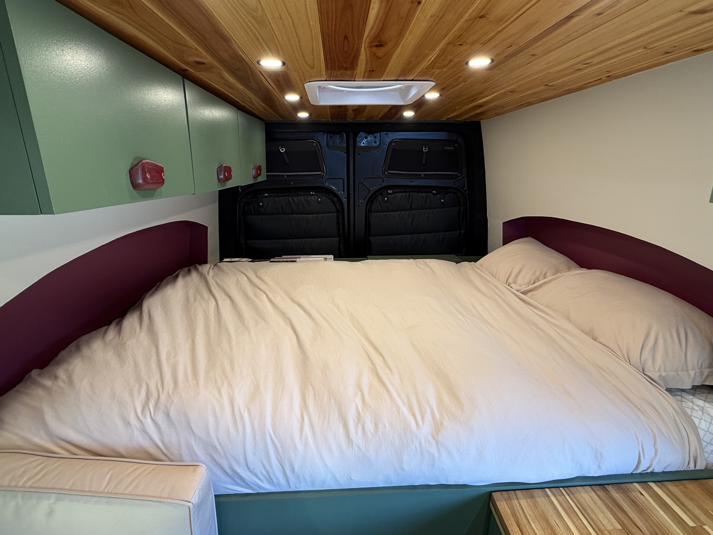
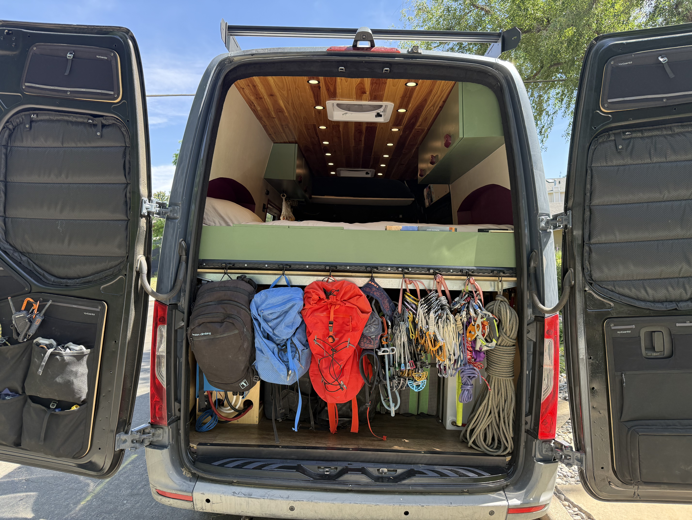
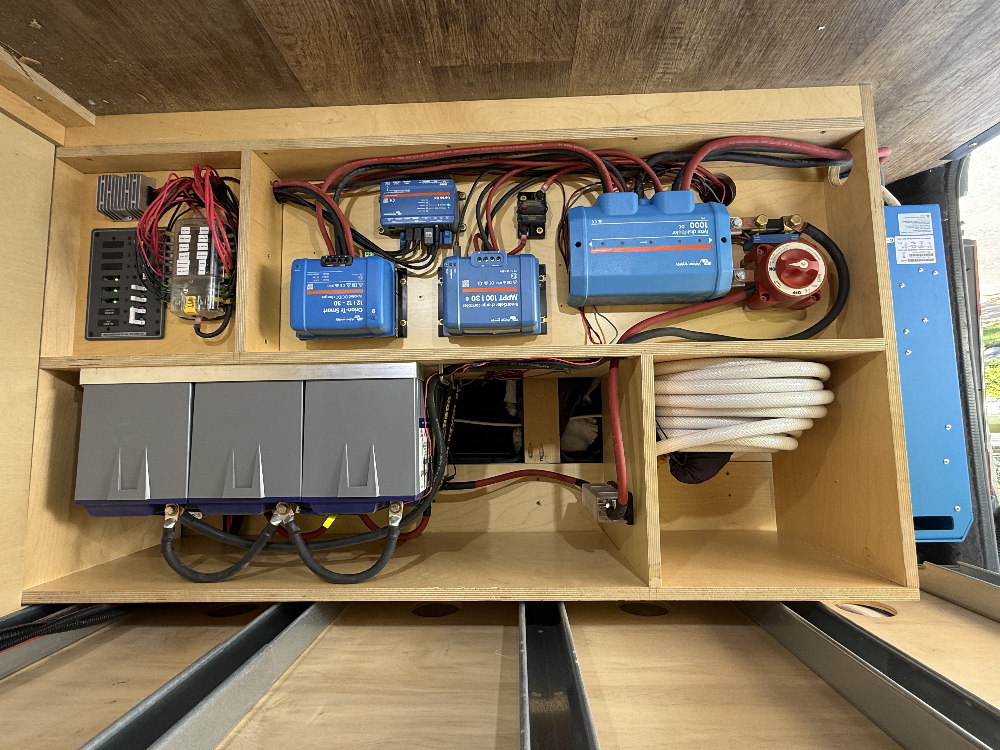
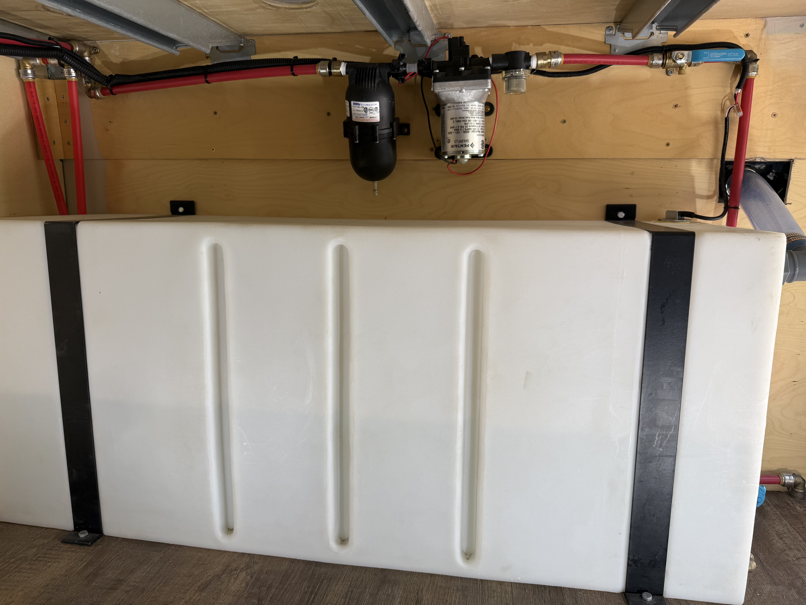
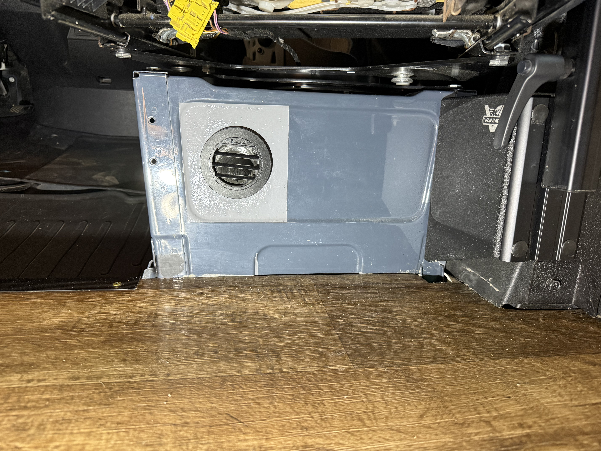
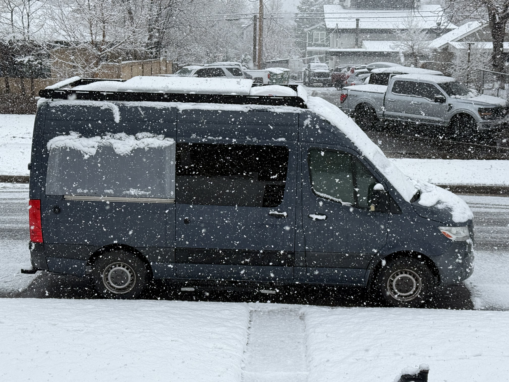
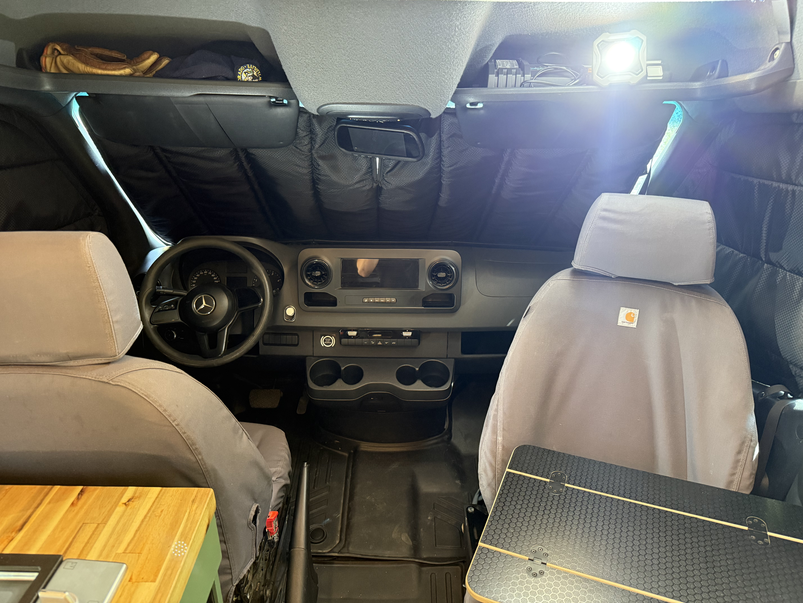

# 2019 Mercedes-Benz Sprinter 2500 — Custom Van Conversion

**144" Wheelbase | High Roof | Full Off-Grid Build**

This document walks through the completed build section by section. Photos for each section are in the corresponding folder.

---

## 🛋️ Living Space

→ [`Living Space/`](./Living%20Space/)

The main living area runs the length of the van behind the cab. It features a custom bench seat with custom couch cushions that can be converted from a banquette seat to an L-bench seat, a Lagun swivel table mounted to the passenger seat base, and a second lagun swivel table mounted to the bench seat. Upper cabinetry with gas struts lines the walls above. The tongue-and-groove pine ceiling with polyurethane finish and Lonseal commercial-grade flooring give the interior a warm, finished feel.

---

## 🍳 Kitchen

→ [`Kitchen/`](./Kitchen/)

The kitchen is built around a 2-burner propane cooktop with an undermount Manchester 7-gallon tank and solenoid for safe propane regulation. A Dometic NRX 4 cu. ft. 12V/24V compressor refrigerator keeps food cold without drawing excessive power. The custom cabinetry is built from Baltic birch with soft-close drawer slides and hinges, finished in Rubio Monocoat wood oil. An integrated VanTec sink connects to the fresh water system. A magnetic spice rack and fruit hammock sit above the stove.

---

## 🛏️ Bed

→ [`Bed/`](./Bed/)

The sleeping platform utilizes two Vanspeed Flares that allow for a full size mattress for comfortable full-time use. Heater, Light, and charging controls are convenientaly located for access from the bed or kitchen. The layout allows for gear storage underneath and integrates cleanly with the rest of the living space.

---

## 🔧 Garage

→ [`Garage/`](./Garage/)

The garage area provides dedicated storage for gear, tools, and outdoor equipment. The Sprinter storage door panel bundle maximizes usable space on the rear and side doors.

---

## ⚡ Electrical

→ [`Electrical/`](./Electrical/)

The electrical system is built around a full **Victron Energy ecosystem**:

- **Batteries:** 300Ah LiFePO4 (3x 100Ah 12V Battle Born) — with room to expand
- **Inverter:** Victron 2000W
- **Solar:** 390W (3x 130W monocrystalline panels) via Victron MPPT charge controller
- **Alternator charging:** Victron Orion-Tr DC-DC charger
- **Monitoring:** Victron Cerbo GX hub + GX Touch 70 display screen + smart shunt
- **Shore power:** 30A/125V inlet for campground hookups
- **Panel:** Blue Sea Systems AC and DC panel with full circuit protection and fuse block
- **Outlets:** USB-C DC outlets and 15A GFCI outlets throughout
- **Controls:** 4-gang marine rocker switch panel with color-coded momentary buttons

---

## 💧 Plumbing

→ [`Plumbing/`](./Plumbing/)

Fresh water is stored in a 35-gallon wheel-well mounted tank. The system includes a water pump, strainer, and accumulator for consistent pressurized flow, a water level sensor, and heated pipes for freeze protection in cold climates. An external water inlet makes refilling easy without opening the van.

---

## 🔥 Heater

→ [`Heater/`](./Heater/)

An **Espar diesel heater** provides reliable heat in any conditions. It runs off the van's diesel tank, draws minimal fuel and is thermostatically controlled, making it ideal for cold-weather camping or full-time winter living. Complemented by full multilayer insulation: 3M Thinsulate acoustic/thermal, Low-E reflective radiant barrier, and Kilmat sound deadening throughout the walls, floor, and ceiling.

---

## 🚐 Exterior

→ [`Exterior/`](./Exterior/)

The exterior features **Van Speed Flares** with Phoenix coating, an **Arctic Tern window**, and a **roof rack** carrying the solar array. Two **Maxxair roof fans** provide ventilation and airflow. The 7-piece all-season window cover kit and roof vent covers provide privacy and insulation year-round.

---

## 📡 Cabin

→ [`Cabin/`](./Cabin/)

The cab area includes the Scopema passenger swivel seat and one of the Lagun table setups, making the front of the van function as an extension of the living space. The cabin features **Apple Carplay** and two rear cameras. **Starlink Mini** with a roof mount provides high-speed internet anywhere, fully integrated into the electrical system for seamless connectivity on the road.

---

## Build Stats

| Spec             | Detail                           |
| ---------------- | -------------------------------- |
| Base Van         | 2019 Mercedes-Benz Sprinter 2500 |
| Wheelbase        | 144"                             |
| Roof             | High Roof                        |
| Mileage          | 103,000 miles                    |
| Battery Capacity | 300Ah LiFePO4                    |
| Solar            | 390W                             |
| Fresh Water      | 35 gallons                       |
| Inverter         | 2000W                            |
| Internet         | Starlink Mini                    |
| Heating          | Espar Diesel                     |
